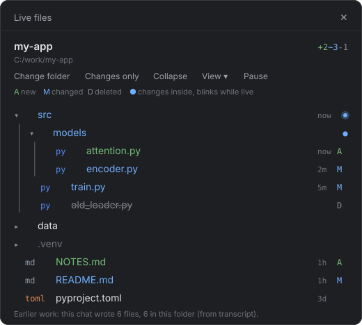

# Claude Code Live File Explorer

**See every file Claude touches, live, right beside the chat.**

A plugin for the [Claude Code](https://claude.com/claude-code) desktop app. It adds a file explorer pane next to your conversation that shows your project as a tree and marks, as it happens, every file Claude creates, edits or deletes. No more scrolling back through tool calls to work out what changed.

<p align="center">
  
</p>

## Why

When Claude works on a big task it can touch dozens of files across many folders. The built-in Files pane shows your files but not what changed, and the diff view needs a git repo. Live files answers "what did Claude just do, and where?" at a glance, in any folder, git or not.

## What you get

- **Live change marks**: **A** for new files (green), **M** for changed (blue), **D** for deleted (grey, struck through), refreshed every couple of seconds.
- **Follow the work**: folders with changes inside turn blue, open by themselves, and their dot blinks while the change is fresh.
- **It remembers**: files Claude wrote earlier in the chat are marked too, even after a long chat was compacted.
- **Click to open**: any file opens in the app's own viewer (code, Markdown, PDF).
- **A JetBrains-style tree**: folders first, file type tags, indent guides.
- **View menu**: toggle size, age, type tags, the A/M/D key, ignored folders, dotfiles, indent guides, auto-open, and recent-first sorting.
- **Pause**: freeze the tree while you read; resume catches up on everything.
- **Changes only**: hide everything that did not change.
- Stays fast on big projects: `.venv`, `node_modules`, `.git` and similar folders are listed but never scanned.

## Install

**In the Claude Code desktop app:** click **+** next to the prompt box, then **Plugins**, **Add marketplace**, enter `yaqzans/claude-code-live-file-explorer`, then **Add plugin**.

**Or from a terminal:**

```bash
claude plugin install live-files --marketplace yaqzans/claude-code-live-file-explorer
```

New chats load it after install. In a chat that is already open, type `/reload-plugins`.

## Use

1. Start a chat. The **Live files** pane opens beside it.
2. The first time, pick the folder to watch: type a path, click through the folder list, or use **Browse with File Explorer...** on Windows. Each chat remembers its own folder and reopens on it; a new chat shows the picker with your Recent folders one click away. **Change folder** picks another.
3. Work with Claude as usual and watch the marks appear.

Closed the pane? Click **Open Live files** above the prompt, or type `/files`. `/files <folder>` opens it straight on a folder.

## Notes

- Built for Claude Code 2.1.304 and later. The plugin API is early access, so a future release may need an update.
- The File Explorer picker is Windows only. Finding earlier writes in long chats uses PowerShell on Windows and `grep` elsewhere.
- Private by design: it only reads your files and the current chat's own transcript on your machine. Nothing is sent anywhere.

## Troubleshooting

If the pane goes blank or stops updating, create an empty file named `live-files-trace.on` in your temp folder (`%TEMP%` on Windows), reproduce the problem, and the pane writes what it was doing to `live-files-trace-<chat>.log` in the same folder. Attach that log to an issue.

## Uninstall

```bash
claude plugin uninstall live-files@live-files
```

## Development

The plugin is one hooks module, `hooks/register.tsx`. Run the tests with:

```bash
claude plugin test .
```

## License

MIT, see [LICENSE](LICENSE).
